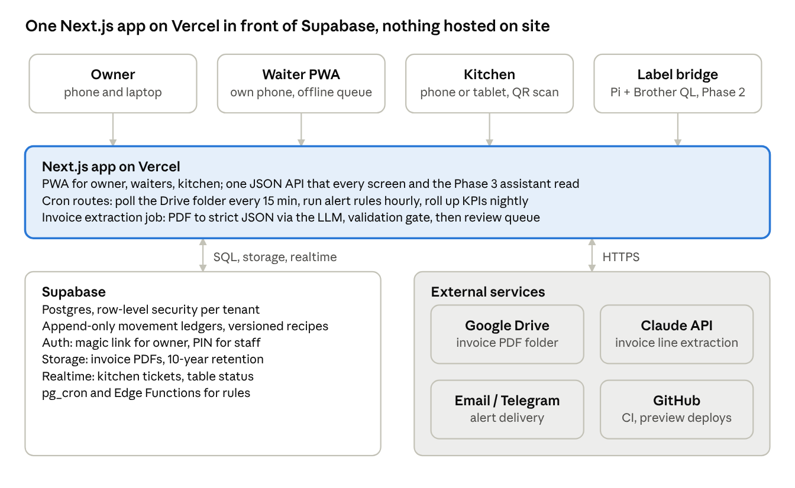
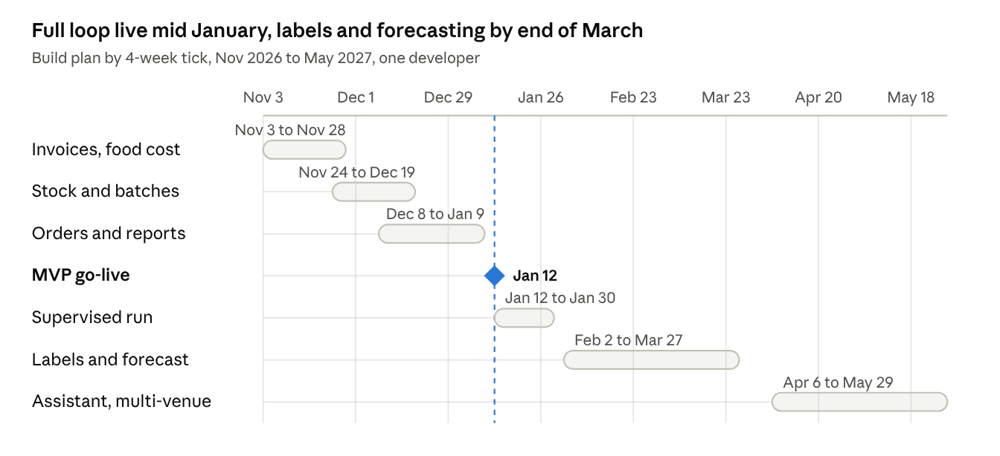

# Osteria Digitalization PRD

Oct 21, 2026 · @Digialto

## Overview and goals

The osteria runs an RCH LDP03 (ASSO 3, Xstore back office) that only fiscalizes sales and exports supplier invoices as PDF. Nothing tracks what was bought, what was cooked, what is in the cold room or what each plate actually costs. This PRD defines a standalone web app, run in parallel to the register, that closes that gap: invoices feed purchase prices and raw stock, recipes turn raw stock into batches and portions, waiter-entered orders deplete portions, and reporting surfaces margins, alerts and what to push before it expires. It supersedes the earlier monitoring and anti-fraud scope, which is dropped.

**Goals (12 months)**

1.  Known food cost per plate, updated automatically whenever a supplier price changes, with fixed costs allocated on a configurable basis.

2.  Live inventory in two layers: raw ingredients (kg, l, pz) and worked batches (portions), both depleted by orders and adjusted by reason-coded corrections.

3.  Alerts that fire early enough to act: prep reminders when portions run low and raw stock allows, purchase reminders that respect supplier lead time and delivery windows, invoice due-date reminders.

4.  A KPI dashboard the owner trusts: covers, average spend, mix, margin per plate, waste, plus a daily push list of plates near end of shelf life.

5.  Low operating burden: 25 invoices a month processed in under 15 minutes of human review, daily counts in under 10 minutes, no server to maintain.

**Non-goals**: replacing the fiscal register, two-way integration with RCH, online ordering, reservations, payroll, customer data of any kind.

**Guiding constraints**: the app is the sales source of truth (the register stays fiscal only, keyed in separately by the cashier); phone-first for waiters and the kitchen; Italian UI; multi-tenant from day one where it costs nothing extra, single-venue UX now.

## Users, roles and devices

Four roles, one tenant, phones first. Everyone logs in with a PIN or magic link; waiters never see costs.

| Role             | Who          | What they do in the app                                                                                | Device                  | Sees costs   |
|------------------|--------------|--------------------------------------------------------------------------------------------------------|-------------------------|--------------|
| Owner            | Titolare     | Approves invoices, sets prices and fixed costs, reads reports, receives purchase and payable reminders | Phone + laptop          | Yes          |
| Chef / kitchen   | Cuoco, aiuto | Registers batches, prints labels, logs waste, does counts, receives prep alerts, fires courses         | Phone or kitchen tablet | Margins only |
| Waiter           | Sala         | Opens a table, enters orders by course, closes the table with the fiscal receipt number                | Own phone (PWA)         | No           |
| Admin (DigiAlto) | You          | Tenant setup, recipe import, support                                                                   | Laptop                  | Yes          |

Accountant access (read-only export of approved invoices) is a Phase 2 role.

**Device assumptions**: iOS and Android phones running the PWA in the browser, no app store; one shared kitchen device optional; label printer on the venue Wi-Fi; no POS integration. Offline tolerance: orders must queue locally and sync when Wi-Fi returns (see Non-functional requirements).

## Scope and phasing

MVP is the full loop on one venue: invoices in, recipes and batches, orders out, stock and margin visible. Automation, forecasting and hardware come after the loop is trusted.

| Capability                                                                                             | MVP                                       | Phase 2           | Phase 3 |
|--------------------------------------------------------------------------------------------------------|-------------------------------------------|-------------------|---------|
| Invoice PDF upload (manual + Drive folder watch), AI line extraction, human review, approve            | Yes                                       |                   |         |
| Supplier and ingredient master data, unit and pack conversions                                         | Yes                                       |                   |         |
| Price history, moving-average cost, last-price variance alert                                          | Yes                                       |                   |         |
| Payables ledger with due dates and reminders                                                           | Yes                                       |                   |         |
| Recipes with sub-recipes, yield and trim factors, batch size, portions per batch, shelf life           | Yes                                       |                   |         |
| Fixed-cost allocation (rent, labour, utilities per plate sold), target food cost %                     | Yes                                       |                   |         |
| Raw stock ledger, daily counts, monthly reconciliation and audit log                                   | Yes                                       |                   |         |
| Batch register (produce, label, consume, discard) with portion tracking                                | Yes                                       |                   |         |
| Orders: tables, courses, items, modifiers, table close with receipt number                             | Yes                                       |                   |         |
| Auto-depletion of portions and raw stock from orders; reason-coded manual deductions                   | Yes                                       |                   |         |
| Alerts: low portions, low raw, prep suggestion, purchase suggestion with lead time and delivery window | Basic (email or Telegram)                 | Full rules engine |         |
| Reporting: covers, average spend, mix, margin per plate, food cost %, waste                            | Yes                                       |                   |         |
| Push list: plates to promote by remaining shelf life                                                   | Yes                                       |                   |         |
| Label printer with QR codes, scan-to-consume                                                           |                                           | Yes               |         |
| Lot traceability from invoice to batch to plate (HACCP)                                                | Lots captured on invoice lines if present | Full chain        |         |
| Demand forecast (covers and plates by weekday, prep list generator)                                    |                                           | Yes               |         |
| Menu engineering matrix, supplier price benchmarking                                                   |                                           | Yes               |         |
| AdE corrispettivi import as a cross-check of app sales vs fiscal                                       |                                           | Yes               |         |
| Kitchen display (KDS)                                                                                  |                                           | Optional          |         |
| Chatbot over reporting API (WhatsApp or Telegram)                                                      |                                           |                   | Yes     |
| Multi-venue UI, accountant portal, purchase orders to suppliers                                        |                                           |                   | Yes     |

**Out of scope**: RCH integration in either direction, anti-fraud reconciliation, reservations, payments, customer data, staff scheduling.

## Market research

The category is mature: every serious product does invoice scanning, recipe costing, par-level alerts and POS-driven depletion. None of them does what this osteria needs at a price that makes sense for one venue without a POS integration (MarketMan starts at \$249/month and depends on the POS feed), and none tracks worked batches as portions with shelf life the way the kitchen thinks about them. That batch-and-portion layer is the differentiator; everything else below is table stakes to copy.

| Product                                                                                                                                               | Target                                    | What it does well                                                                                                                                                                              | Copy this                                                                                                                                                                 | Price (as of Oct 2026)                                                 |
|-------------------------------------------------------------------------------------------------------------------------------------------------------|-------------------------------------------|------------------------------------------------------------------------------------------------------------------------------------------------------------------------------------------------|---------------------------------------------------------------------------------------------------------------------------------------------------------------------------|------------------------------------------------------------------------|
| [MarketMan](https://www.marketman.com/pricing-for-restaurant-inventory-management-system)                                                             | Independents to chains, POS-integrated    | AI invoice scanning that updates stock and prices, price-change alerts, actual vs theoretical (AVT) variance, order-by-recipe, waste logging, credit memos                                     | Price tracking and alerts per ingredient; AVT report (theoretical usage from sales vs counted usage); credit-memo flow for short deliveries                               | Starter \$249/mo (50 scans), Growth \$299/mo, Enterprise from \$449/mo |
| [Nory](https://www.nory.ai/operations/inventory)                                                                                                      | Multi-site groups, AI-first               | Demand forecast per hour from POS history, prep lists and order guides generated from forecast, GP% targets per recipe, invoice matched against PO and delivery note                           | Forecast-driven prep list (Phase 2); GP% target per recipe with alert when a price change breaks it                                                                       | Enterprise, quote only                                                 |
| [Restoke](https://www.restoke.ai/features/inventory)                                                                                                  | Single venues to groups                   | Email-forwarded or photographed invoice updates stock and costs; optimal stock levels drive scheduled orders; checklists and prep procedures for staff                                         | Email-in invoice intake (forward to a mailbox); reorder thresholds tied to a supplier order schedule; prep checklists                                                     | Free app, subscription on site                                         |
| [Supy](https://supy.io/platform-comparison/supy-vs-marketman)                                                                                         | Multi-branch groups, MENA/EU              | Suppliers email invoices straight into the system; procurement, menu engineering, invoices and settlements, central kitchen                                                                    | Statement-of-account reconciliation per supplier; central-kitchen batch production model (we use it for one kitchen)                                                      | Quote only                                                             |
| [Apicbase](https://www.capterra.com/p/171584/APIC-Kitchen-Manager)                                                                                    | Groups and hotels                         | Recipe library with allergens and nutrition, bill-of-materials ordering, production planning, HACCP tasks                                                                                      | Allergen matrix per recipe derived from ingredients; production planning as a daily list                                                                                  | Quote only                                                             |
| [Food Cost in Cloud + Cassa in Cloud](https://www.teamsystem.com/horeca/cassa-in-cloud/funzionalita/integrazioni-software-api/foodcost/) (TeamSystem) | Italian restaurants on the TeamSystem POS | Recipe cost plus operating cost per plate, suggested sale price pushed to the POS, automatic lot assignment and smart labelling, daily and weekly production plans assigned to staff, live P&L | Operating-cost-per-plate concept; auto-lotting of batches; assignable production plans. This is the closest Italian analogue and shows the market expects lots and labels | Bundled with Cassa in Cloud, quote                                     |
| [Qubi](https://www.trustpilot.com/review/qubisoftware.com)                                                                                            | Italian small restaurants                 | Food cost with weight loss and waste, virtual pantry, shopping list, price comparison, HACCP                                                                                                   | Weight-loss (calo peso) factor per recipe step                                                                                                                            | Subscription, reviews flag complexity                                  |
| [Octopus HACCP](https://octopus-haccp.com/en/produit-imprimante-brother-professionnelle/)                                                             | French HACCP compliance                   | Sells the Brother TD-4550DNWB with pre-made secondary shelf-life labels, Bluetooth to a kitchen tablet, label rolls reordered from the app                                                     | The label as the unit of traceability: printed at batch creation with use-by date, scanned at use                                                                         | Printer €499 or €20/mo rental, labels ~€0.007 each                     |

**Features worth adopting beyond the brief**

1.  Actual vs theoretical variance: compare what recipes say was consumed with what the monthly count says disappeared. This is the single most used report in MarketMan and the one that finds theft, over-portioning and unrecorded waste.

2.  Price variance alert on invoice approval: flag any line whose unit price moved more than X% from the last purchase, and show the margin impact on every recipe that uses it.

3.  GP% target per recipe: when a price change pushes a plate below its target, surface it on the owner dashboard.

4.  Credit-memo tracking: short or damaged deliveries recorded against the invoice so the payable reflects what was received.

5.  Email-in intake: a dedicated mailbox the supplier or the owner forwards PDFs to, as an alternative to Drive.

6.  Prep checklists: the chef's morning list generated from low-portion alerts, editable, ticked off on the phone.

7.  Allergen matrix: inherited from ingredients to recipes, printed on the menu. Required by EU 1169/2011 in Italy anyway.

What none of them do, and this PRD does: track a worked batch as a first-class stock item with its own portion count, shelf life and lot, depleted by orders entered by waiters, with the raw ingredients consumed at production time rather than at sale time.

## Module 1: Invoices, food cost engine and payables

Every supplier invoice becomes approved line items that move stock, update prices and create a payable; the owner reviews, never retypes. At 25 invoices a month the target is under 30 seconds of review per invoice once suppliers are mapped.

**1.1 Intake**

- Three entry points, same pipeline: upload in the app (phone camera or PDF), a watched Google Drive folder polled every 15 minutes, and an email-in address (Phase 2).

- Duplicate detection on supplier VAT number + invoice number + date; duplicates are flagged, never silently dropped.

- Original PDF stored in Supabase Storage, linked to the invoice record, kept 10 years (Italian retention for fiscal documents).

**1.2 Extraction**

- Run the PDF through a vision-capable LLM with a strict JSON schema (Zod): supplier, VAT number, invoice number, date, due date, payment terms, lines (description, quantity, unit, unit price, VAT rate, lot number, expiry if printed), totals. Text-layer PDFs are parsed directly; scans go through the same model as images.

- Validation gate: sum of lines must equal the invoice total within €0.05, else the invoice lands in review with the mismatch highlighted.

- Confidence per field; anything below threshold is highlighted for the reviewer.

- Supplier line descriptions are mapped to ingredients once, then remembered (supplier item code or description hash → ingredient + pack size). First invoice from a supplier is slow; the second is nearly automatic.

- If FatturaPA XML is available later (commercialista export, AdE cassetto fiscale), the same pipeline accepts XML and skips the model entirely.

**1.3 Review and approval**

- Side-by-side: PDF on the left, extracted lines on the right, unmapped lines first.

- Reviewer can split a line (one invoice line = two ingredients), set pack conversion (1 cassa = 6 × 1 kg), mark a line as non-stock (gas, cleaning, service fee → cost centre, not inventory), record a short delivery (credit memo) or a lot number.

- Approval posts: stock receipt per line (raw layer), price history entry, payable with due date.

**1.4 Food cost engine**

- Ingredient cost basis: moving average over the last N purchases (default N=3), with last price and max price visible. Switchable per ingredient to last price.

- Recipe cost = Σ (ingredient quantity × unit cost ÷ yield factor) + Σ sub-recipe cost per quantity used. Yield factor covers trim and cooking loss (1 kg beef muscle at 0.82 yield → 0.82 kg usable).

- Batch recipe: declares batch output (e.g. 6 kg stew) and portions per batch (e.g. 30); cost per portion = batch cost ÷ portions. Plate recipe references batch portions plus plating ingredients (bread, garnish).

- Fixed-cost allocation (default): monthly rent + labour + utilities ÷ plates sold in the trailing 30 days = fixed cost per plate, added to every plate. Alternative bases selectable later: per cover, percentage uplift on food cost, per minute of prep time.

- Outputs per plate: food cost, fixed cost, full cost, sale price (VAT excluded), gross margin €, food cost %, GP%, target GP% and status.

- Recipes are versioned; a price change does not rewrite history. Reports use the cost in force on the day of sale.

- Price variance alert: on approval, any ingredient whose unit price moved more than 10% (configurable) from the moving average raises an alert listing the recipes affected and the new margin.

**1.5 Payables and reminders**

- Payable per invoice: amount, due date (from terms or extracted), status (open, scheduled, paid, disputed), paid date entered by the owner.

- Reminders: 7 days before, on due date, 3 days after if still open; weekly digest of open payables by supplier.

- Supplier statement view: open invoices and credit memos per supplier for monthly settlement.

- Accountant export (Phase 2): CSV of approved invoices with VAT breakdown.

**Acceptance criteria**: 90% of lines from a mapped supplier need no correction; an invoice with a total mismatch cannot be approved; approving an invoice updates the moving average and every recipe cost within 5 seconds; a duplicate invoice is blocked.

## Module 2: Inventory, production batches and alerts

Stock lives in two layers that move at different moments: raw ingredients move when an invoice is approved and when a batch is produced; worked batches move when a batch is produced and when a plate is ordered. Both layers are ledgers of movements, never editable balances, so the monthly audit can always explain a number.

**2.1 Raw layer**

- One stock record per ingredient per location (cella, freezer, dispensa; one location is fine at start). Base unit per ingredient (kg, l, pz); pack conversions live on the supplier item, not the ingredient.

- Movements: receipt (invoice), consumption (batch production or direct plate use), count adjustment, waste (reason-coded), transfer between locations.

- Lot tracking: a receipt carries supplier lot and expiry when present on the invoice or typed at receiving. Consumption is FEFO by default (earliest expiry first) so the chef does not choose a lot unless overriding.

- Daily quick count: a list of the 15-20 ingredients the chef flagged as critical, entered in under 5 minutes on the phone; the app shows the expected quantity and asks only for the actual.

- Monthly full count: all ingredients, variance report (expected vs counted, in units and €), audit log of who adjusted what.

**2.2 Worked layer (batches)**

- A batch is created from a batch recipe: the chef picks the recipe, enters actual output (6.2 kg, default from recipe), the app computes portions (6.2 ÷ 0.2 = 31) and proposes the raw consumption from the recipe scaled to the output. The chef confirms or edits actual quantities used (if 5.3 kg beef went in instead of 5.0, the ledger records 5.3).

- Batch fields: id, recipe version, produced at, produced by, output quantity, portions initial, portions remaining, shelf life (from recipe, overridable), use-by date, lot number (auto: YYMMDD-recipe-seq), state (fresh, open, finished, discarded), location.

- Batch cost is frozen at production with the raw lots consumed, so a batch made before a price increase keeps its old cost.

- Portions deplete from the oldest fresh batch first (FEFO). A plate that uses half a portion depletes 0.5.

- Manual actions on a batch: adjust remaining (count), discard (waste, reason), split (half frozen, with a new shelf life), reprint label.

- Label (Phase 2 hardware, manual label text in MVP): recipe name, produced, use-by, portions, lot, QR encoding the batch id. Scanning the QR on a phone opens the batch for adjust, discard or consume.

**2.3 Depletion from orders**

- Every ordered item maps to a plate recipe. When the item is sent to the kitchen (not when the table closes), the app depletes batch portions and direct raw ingredients.

- Voids restore stock if the item was not yet fired; after firing, a void becomes waste with a reason.

- Items without a recipe mapping are allowed (drinks, specials) and listed in a weekly "unmapped items" report so coverage improves over time.

**2.4 Reorder and prep rules**

- Per ingredient: minimum level, target level, lead time (days) per supplier, delivery weekdays (e.g. Mon/Thu), order cut-off time.

- Per batch recipe: minimum portions, target portions, prep time (hours).

- Prep alert (the user's example): stew remaining \< 5 portions AND beef muscle on hand ≥ quantity for one batch → "Prepare stew today, 5.0 kg beef available (12.3 kg on hand)". If raw is short, the alert becomes a purchase suggestion instead.

- Purchase alert: projected stock (on hand minus forecast consumption over lead time plus days to next delivery window) falls below minimum → "Order 10 kg beef from Macelleria X by Tue 11:00 for Thu delivery". In MVP forecast consumption is the trailing 14-day average per weekday; Phase 2 replaces it with the demand model.

- Expiry alert: raw lot or batch within 1 day of use-by with remaining quantity → feeds the push list in reporting and a kitchen notification.

- Alerts are deduplicated (one per item per day), acknowledged with one tap, and delivered on the channel chosen in setup. Default channel is email to one address; Telegram bot as the first upgrade because it needs no business verification; WhatsApp Business API later if wanted.

**2.5 Waste and corrections**

- Reason codes: spoilage, expired, over-production, plating error, staff meal, comp, breakage, count correction. Each writes a movement with a cost, so waste is reported in €.

- Staff meals can be a recurring daily entry (default recipe, default count) confirmed with one tap.

**Acceptance criteria**: producing a batch reduces raw stock by the confirmed quantities and creates N portions within one transaction; an order fired for a plate reduces the right batch by one portion; the monthly variance report reconciles opening + receipts − consumption − waste ± adjustments = counted for every ingredient; the stew example above produces the prep alert within the hourly rules run.

## Module 3: Orders (sala)

The orders screen is the only thing waiters touch, so it must be faster than a paper pad: open table, tap items by course, send, done. It runs in parallel to the register; the cashier keys the same items into the RCH to print the fiscal receipt, and the table is closed in the app with the receipt number so sales can be reconciled later.

**3.1 Tables and service**

- Table list with status (free, open, courses sent, bill requested, closed), covers, waiter, open time. A simple grid of named tables, no floor plan in MVP.

- Covers entered at opening; coperto applied automatically if configured.

- Multiple waiters can edit the same table; last write wins per line, no locking.

**3.2 Order entry**

- Menu grouped by category with the day's unavailable items greyed out automatically when the mapped batch has 0 portions (86'd by stock, not by memory).

- Courses: antipasti, primi, secondi, dolci, bevande, plus "segue" markers. Items can be moved between courses.

- Modifiers: free-text note per item (senza cipolla), half portion (depletes 0.5), shared plate.

- Low-stock hint on the item: "3 portions left" shown to the waiter so they stop selling before the kitchen runs out.

- Push suggestions: items on today's push list are pinned at the top of the menu with a small marker so the waiter proposes them first.

**3.3 Sending and kitchen**

- "Send" fires a course to the kitchen. In MVP the kitchen sees a chronological ticket list on a phone or tablet (web page, no hardware). A kitchen ticket printer (ESC/POS over Wi-Fi) is an optional Phase 2 add-on; a KDS with bump bar is Phase 2 optional.

- Firing is the depletion event (Module 2.3). Re-fire of a course after a kitchen error is a void with reason.

**3.4 Closing**

- Bill preview: lines, coperto, total (VAT inclusive), split by covers or by items. The app never takes payment and never issues fiscal documents.

- Close requires the RCH receipt number (or "fattura" + number) and payment type; this is the key for reconciling app sales with register totals in reporting.

- End of day: app total vs register total entered by the owner; variance shown, with a list of app tables closed without a receipt number.

**3.5 Offline**

- Orders queue in IndexedDB when the phone drops Wi-Fi and sync in order when back; conflicts are resolved server-side by timestamp with a visible warning.

**Acceptance criteria**: a 4-cover table with 3 courses is entered in under 90 seconds by a waiter after one training session; an item mapped to an empty batch cannot be ordered; closing without a receipt number is allowed but flagged; the end-of-day variance is visible before midnight.

## Module 4: Reporting and forecasting

The owner opens one screen in the morning and knows three things: what to push today, how yesterday went, and what is losing money. Everything else is a drill-down.

**4.1 Push list (daily, top of the dashboard)**

- Batches and raw lots sorted by hours to use-by, with portions remaining, cost at risk in €, and the plates that use them. Example line: "Spezzatino, made Mon, use by Wed 20:00, 14 portions, €38 at risk → push Spezzatino con polenta".

- One tap marks a plate as "push today": it is pinned in the waiters' menu (Module 3.2) and can carry a temporary price.

- Phase 2: the list also shows yesterday's sell-through of pushed items so the owner learns which pushes work.

**4.2 KPIs (daily, weekly, monthly, custom range, with same-period comparison)**

| KPI                           | Definition                                                    | Source           |
|-------------------------------|---------------------------------------------------------------|------------------|
| Covers                        | Σ covers on closed tables                                     | Orders           |
| Revenue (net of VAT)          | Σ closed table totals ÷ (1 + VAT)                             | Orders           |
| Average spend per cover       | Revenue ÷ covers                                              | Orders           |
| Average ticket                | Revenue ÷ tables                                              | Orders           |
| Plates sold by item           | Count per menu item, half portions as 0.5                     | Orders           |
| Mix %                         | Item plates ÷ total plates                                    | Orders           |
| Food cost %                   | Σ recipe cost of plates sold ÷ revenue                        | Orders + recipes |
| Gross margin per plate        | Price (ex VAT) − full cost                                    | Recipes          |
| Contribution by item          | Margin × plates sold                                          | Orders + recipes |
| Purchases                     | Σ approved invoice lines (stock only)                         | Invoices         |
| Waste €                       | Σ waste movements at cost, by reason                          | Inventory        |
| Actual vs theoretical         | Counted consumption − recipe consumption, by ingredient, in € | Counts + orders  |
| App vs register               | App closed totals vs register total entered                   | Orders + manual  |
| Covers per hour / per weekday | Distribution for staffing                                     | Orders           |

**4.3 Menu engineering (Phase 2)**

- Classic 2×2 of popularity (mix % vs mean) against margin (contribution vs mean): stars, plowhorses, puzzles, dogs. Recalculated weekly; each quadrant with a suggested action (reprice, reposition, re-recipe, remove).

**4.4 Forecasting**

- MVP: expected covers and plates per weekday = trailing 4-week average for that weekday, shown next to current portions so the chef sees "Thu usually sells 22 stew, you have 14".

- Phase 2: model per item on weekday, week of year, weather (open-meteo, free) and local events flag; outputs a prep list (batches to make, quantities) and an order guide (what to order from whom by when), both editable and accepted with one tap. Accuracy tracked as MAPE per item and shown so the owner knows whether to trust it.

**4.5 Exports**

- Every table exportable to CSV; monthly pack (KPIs, purchases, waste, variance) as PDF for the accountant.

**Acceptance criteria**: the dashboard loads in under 2 seconds on a phone over 4G; yesterday's KPIs are final by 03:00; the push list only shows items with remaining quantity above zero; food cost % on the dashboard matches the sum of the item-level report.

## Traceability and labelling

Traceability falls out of the ledger for free: an invoice line carries the supplier and lot, a batch records which raw lots it consumed, and an order records which batch fed the plate. The only extra effort is capturing the supplier lot at receiving when the invoice does not print it, which is one optional field in the review screen.

- Lot on receipt: extracted from the invoice if printed, else typed or photographed from the packaging label at receiving (optional in MVP, encouraged in Phase 2).

- Batch lot: auto-generated and printed on the label. Batch → raw lots link is stored at production.

- Forward trace: given a supplier lot (recall), list the batches and the plates served and when. Backward trace: given a batch, list the raw lots and suppliers.

- HACCP registers that the app can replace at low cost in Phase 2 because the data is already there: secondary shelf-life labelling (etichettatura secondaria), lot register, non-conformity log (waste with reason). Temperature logs and cleaning plans stay out of scope unless a cheap sensor option is wanted later.

- Labels: 62 mm continuous or 62×29 mm die-cut, black on white; contents: recipe, produced date and time, use-by, portions, lot, QR with batch id, operator initials. A label is printed at batch creation and reprinted on split. Raw items decanted from supplier packaging get a label too (ingredient, received, use-by, supplier lot).

- Scan-to-act: scanning any label with the phone camera opens the batch or lot with adjust, discard, consume and "print again" actions. No app install; the QR is a URL into the PWA.

## Virtual assistant (nice to have, Phase 3)

The assistant is a thin chat layer over the same reporting and alert APIs, not a separate product, so it costs days rather than weeks once the APIs exist.

- Channel: Telegram first (free bot API, no business verification), WhatsApp Business later if the owner insists.

- Scope: read-only questions ("quanti coperti ieri?", "quanto spezzatino rimane?", "cosa devo ordinare per giovedì?") answered by calling the report and inventory endpoints with tool use; a small set of write actions behind confirmation ("segna la fattura 123 come pagata", "scarta 3 porzioni di spezzatino").

- Design rule from day one: every screen in the app is backed by an API that returns JSON, with no logic in the UI, so the assistant and the dashboard read the same numbers.

- Guardrails: tenant-scoped, role-scoped (waiters cannot ask for margins), every answer cites the report it came from, no free-form SQL.

## Architecture and tech stack

Serverless, one repo, no machine in the restaurant. The only hardware that ever touches the venue network is the optional label printer and its bridge.

system architecture · clients, app, data, external services

Phones hit a single Next.js app on Vercel; it reads and writes Supabase and calls the LLM, Drive and the alert channel on the way.

| Layer              | Choice                                                                                                                                  | Why                                                                                                          | Monthly cost (1 venue) |
|--------------------|-----------------------------------------------------------------------------------------------------------------------------------------|--------------------------------------------------------------------------------------------------------------|------------------------|
| Frontend           | Next.js 15 (App Router), TypeScript, Tailwind, PWA with service worker and IndexedDB queue                                              | One codebase for owner, waiter and kitchen; installable on a phone without an app store; offline order queue | included in Vercel     |
| Hosting and API    | Vercel (Hobby for pilot, Pro when billing a client), route handlers for the JSON API, Vercel Cron for schedules                         | Preview deploys per PR, zero ops                                                                             | €0 to €20              |
| Database           | Supabase Postgres with RLS, tenant_id on every table                                                                                    | Multi-tenant from day one at no extra effort; Realtime for kitchen tickets; Storage for PDFs                 | €0 to €25              |
| Scheduled logic    | Vercel Cron → API routes; heavier rollups as Postgres functions on pg_cron                                                              | Keeps logic next to the data; no queue service                                                               | €0                     |
| Invoice extraction | Claude API with a Zod/JSON schema and PDF input; fallback OCR (Tesseract via a Supabase Edge Function) only for scans the model refuses | 25 invoices/month is ~€1-3 of tokens; no OCR SaaS subscription                                               | €3                     |
| File intake        | Google Drive API (service account on a shared folder) polled by cron; Resend inbound email in Phase 2                                   | Owner already uses Drive                                                                                     | €0                     |
| Alerts             | Resend (email) in MVP; Telegram Bot API in Phase 2; WhatsApp Business via Twilio or Meta in Phase 3                                     | Telegram needs no verification and supports buttons for one-tap acknowledge                                  | €0 to €10              |
| Auth               | Supabase Auth: magic link for owner and admin, 4-digit PIN per staff member on a venue device code                                      | Waiters do not have emails to manage                                                                         | €0                     |
| Source and CI      | GitHub, GitHub Actions for lint/test, Vercel for deploy                                                                                 | Standard                                                                                                     | €0                     |
| Monitoring         | Vercel analytics and logs, Sentry free tier                                                                                             | Enough for one venue                                                                                         | €0                     |

**API first**: every screen reads /api/\* endpoints returning JSON; no data logic in React components. This is what makes the Phase 3 assistant, a future RCH import, or a second front end cheap.

**Integrity rules enforced in Postgres**: stock balances are views over movement ledgers; batch production and order firing are single transactions (stored procedures) so partial writes cannot happen; recipes are immutable rows with a version number and a valid_from.

**Label bridge (Phase 2)**: a Raspberry Pi Zero 2 W on the venue Wi-Fi running brother_ql_web in Docker, exposing a local REST endpoint; the app's print job is a PNG rendered server-side and posted to the bridge, or printed via Brother's AirPrint from the phone when the bridge is absent. See Hardware.

**Running cost target**: under €50/month all-in for one venue; under €10/month marginal per additional venue.

## Data model

Twenty tables, every one with tenant_id, created_at, created_by; balances are never stored, only derived from the two movement ledgers. Chains: supplier_item → invoice_line → raw_lot → batch_input → batch → order_line is the traceability path in both directions.

| Table          | Key fields                                                                                                                                                                            | Relations and notes                           |
|----------------|---------------------------------------------------------------------------------------------------------------------------------------------------------------------------------------|-----------------------------------------------|
| tenant         | name, vat_number, timezone, currency, settings (fixed-cost basis, alert channel, variance threshold)                                                                                  | one per venue                                 |
| user           | role (owner, chef, waiter, admin), pin_hash, auth_id                                                                                                                                  | belongs to tenant                             |
| supplier       | name, vat_number, lead_time_days, delivery_weekdays\[\], order_cutoff_time, payment_terms_days                                                                                        |                                               |
| supplier_item  | supplier_id, ingredient_id, supplier_code, description_hash, pack_qty, pack_unit, last_price                                                                                          | the mapping memory for extraction             |
| ingredient     | name, base_unit (kg, l, pz), category, min_level, target_level, is_stock, allergens\[\], default_shelf_life_days                                                                      | cost_basis (avg3 or last)                     |
| location       | name (cella, freezer, dispensa)                                                                                                                                                       |                                               |
| invoice        | supplier_id, number, date, due_date, total, vat_total, status (extracted, review, approved, rejected), pdf_path, extraction_json, confidence                                          | unique (supplier_id, number, date)            |
| invoice_line   | invoice_id, raw_description, ingredient_id, qty, unit, unit_price, vat_rate, lot_code, expiry, is_stock, credit_qty                                                                   |                                               |
| payable        | invoice_id, amount, due_date, status (open, scheduled, paid, disputed), paid_at                                                                                                       | reminders read this                           |
| price_history  | ingredient_id, supplier_id, unit_price, invoice_line_id, effective_at                                                                                                                 | moving average computed here                  |
| recipe         | name, type (batch, plate, sub), version, valid_from, output_qty, output_unit, portions_per_batch, portion_unit, shelf_life_hours, prep_time_min, sale_price, target_gp_pct, is_active | immutable per version                         |
| recipe_line    | recipe_id, ingredient_id or sub_recipe_id, qty, unit, yield_factor                                                                                                                    |                                               |
| menu_item      | name, category, course_default, recipe_id, price, vat_rate, is_available, is_pushed, push_until                                                                                       | what waiters see                              |
| raw_lot        | ingredient_id, location_id, invoice_line_id, lot_code, expiry, qty_received                                                                                                           |                                               |
| stock_movement | ingredient_id, raw_lot_id, location_id, qty (signed), type (receipt, consumption, count, waste, transfer), reason_code, ref_type, ref_id, unit_cost                                   | raw ledger                                    |
| batch          | recipe_id, recipe_version, lot_code, produced_at, produced_by, output_qty, portions_initial, use_by, state, location_id, unit_cost_frozen                                             | worked item                                   |
| batch_input    | batch_id, raw_lot_id, qty                                                                                                                                                             | traceability link                             |
| batch_movement | batch_id, portions (signed), type (produce, consume, count, waste, split), reason_code, ref_type, ref_id                                                                              | worked ledger                                 |
| table_session  | table_name, covers, waiter_id, opened_at, closed_at, receipt_number, receipt_type, payment_type, total                                                                                | the sale                                      |
| order_line     | table_session_id, menu_item_id, course, qty (0.5 allowed), note, fired_at, voided_at, void_reason, unit_price, unit_cost_at_sale                                                      | depletion happens on fired_at                 |
| alert          | type, entity_type, entity_id, message, severity, created_at, acknowledged_at, channel, sent_at                                                                                        | deduplicated per entity per day               |
| count_session  | location_id, type (daily, monthly), started_by, closed_at                                                                                                                             | count lines are stock_movements of type count |

**Derived views**: v_stock_on_hand (Σ movements by ingredient and lot), v_batch_portions (Σ batch_movements), v_recipe_cost (recursive over recipe_line with current price basis), v_daily_kpi (materialized nightly).

**Stored procedures**: produce_batch(recipe, output_qty, inputs\[\]), fire_course(table_session, lines\[\]), void_line(line, reason), approve_invoice(invoice), each one transaction.

## Hardware

Nothing is required for the MVP: phones, the existing register and Wi-Fi are enough. One label printer is the first purchase worth making, because it turns every worked batch into a scannable object and replaces the handwritten tape the kitchen must produce anyway for HACCP.

| Item                   | Purpose                                                                    | Recommendation                                                                                                                                                                                                                                                                                                                                                                                                                        | Price (as of Oct 2026) | Phase        |
|------------------------|----------------------------------------------------------------------------|---------------------------------------------------------------------------------------------------------------------------------------------------------------------------------------------------------------------------------------------------------------------------------------------------------------------------------------------------------------------------------------------------------------------------------------|------------------------|--------------|
| Label printer          | Batch and decant labels with QR, use-by, lot                               | [Brother QL-820NWB](https://www.mediaworld.it/it/product/_stampante-per-etichette-brother-ql-820nwbvmxx1-151104171.html): Wi-Fi, LAN, Bluetooth, AirPrint, 62 mm, black and red on DK media, free SDK; the open-source [brother_ql_web](https://github.com/marcelcoding/brother_ql_web) REST service drives it from any app. Alternative for a wetter kitchen: Brother TD-4550DNWB (industrial, what Octopus HACCP ships, about €499) | ~€200                  | 2            |
| Print bridge           | Receives print jobs from the cloud app and talks to the printer on the LAN | Raspberry Pi Zero 2 W running brother_ql_web in Docker, outbound-only tunnel (Cloudflare Tunnel or Tailscale) so no port is opened on the venue router. Fallback with no bridge: AirPrint from the kitchen phone                                                                                                                                                                                                                      | ~€30                   | 2            |
| Label media            | Removable, freezer-safe, no residue after washing                          | Brother DK-22205 continuous 62 mm, or third-party removable rolls (~€0.01 per label)                                                                                                                                                                                                                                                                                                                                                  | ~€15 per roll          | 2            |
| Kitchen tablet         | Ticket list, batch registration, counts, QR scanning                       | Any 10" Android tablet in a splash-proof case, or a retired iPad; wall mount near the pass                                                                                                                                                                                                                                                                                                                                            | €150-250               | 2 (optional) |
| Kitchen ticket printer | Paper tickets per course when a screen is not wanted                       | Epson TM-m30III or any ESC/POS printer with Ethernet or Wi-Fi, driven by the same bridge                                                                                                                                                                                                                                                                                                                                              | ~€250                  | 2 (optional) |
| Bluetooth scale        | Weigh batch output and raw receipts without typing                         | Any Web Bluetooth capable kitchen scale (Etekcity, Renpho) read by the PWA in Chrome on Android; iOS lacks Web Bluetooth, so this is Android-only                                                                                                                                                                                                                                                                                     | €30-60                 | 3 (optional) |
| Barcode scanner        | Receiving by EAN for packaged goods                                        | Phone camera is enough at 25 invoices a month; a 2D scanner only if receiving becomes a bottleneck                                                                                                                                                                                                                                                                                                                                    | €60-120                | 3 (optional) |
| Temperature sensors    | Cold room and freezer logs for HACCP                                       | Not in scope; if wanted, a Wi-Fi sensor with an API (Shelly H&T, SensorPush) can post into the same alerts table                                                                                                                                                                                                                                                                                                                      | €40-80 each            | later        |

**Why QR on the label matters**: raw stock is traceable from invoices without any hardware; worked stock is not, because it is created in the kitchen with no document. The label is the document. Scanning it to adjust, discard or consume keeps the worked ledger honest with zero typing, and the use-by printed on it is the same number the push list uses.

**What not to buy**: a POS integration kit or an RCH partner API licence. The app is designed to be correct without the register; reconciliation is done at close with the receipt number and at end of day with the register total.

## Non-functional requirements and running costs

| Area                  | Requirement                                                                                                                                                                                                                               |
|-----------------------|-------------------------------------------------------------------------------------------------------------------------------------------------------------------------------------------------------------------------------------------|
| Performance           | Order entry actions under 300 ms on 4G; dashboard under 2 s; invoice extraction under 60 s per PDF, asynchronous with a status badge                                                                                                      |
| Availability          | Service hours 11:00 to 24:00 are the critical window; orders must survive a Vercel or Supabase outage of up to 30 minutes through the offline queue                                                                                       |
| Offline               | Waiter PWA queues order writes in IndexedDB and replays in order; read data (menu, table list) cached by service worker; kitchen screen shows a stale banner after 60 s without a heartbeat                                               |
| Security              | RLS on every table by tenant; roles enforced in Postgres policies, not only in the UI; PINs hashed; magic-link sessions 30 days; no customer personal data stored at all; invoice PDFs private with signed URLs                           |
| Privacy and retention | Supplier data and invoices are business records (10-year retention); staff names and PINs only; GDPR register entry for staff accounts; EU region for Supabase and Vercel functions                                                       |
| Auditability          | Every movement, approval, void and count carries user and timestamp; nothing is deleted, only reversed                                                                                                                                    |
| Localisation          | Italian UI and number formats (comma decimal, € after amount), English as a second locale; dates Europe/Rome                                                                                                                              |
| Accessibility         | Large tap targets (min 44 px) for waiters, high-contrast kitchen mode, works in Safari iOS and Chrome Android of the last 2 years                                                                                                         |
| Testing               | Unit tests on the cost engine and depletion procedures with fixture recipes (the stew example is a test case); contract tests on the extraction schema with 10 real anonymised invoices; one end-to-end service simulation before go-live |
| Observability         | Sentry for errors, Vercel logs for API, a nightly job that checks ledger invariants and emails any drift                                                                                                                                  |
| Backups               | Supabase daily backups (Pro) plus a weekly pg_dump to Drive                                                                                                                                                                               |

**Running costs, one venue**: Vercel €0-20, Supabase €0-25, Claude API €3, Resend €0, Sentry €0, domain €10/yr. Expected total €5-50 per month depending on free-tier use; hardware one-off €250-500 in Phase 2.

## Risks, assumptions and open questions

The product risk is adoption, not technology: if waiters skip the app on a busy Saturday, depletion is wrong and every report downstream is wrong. Mitigation is built into the design (faster than paper, 86'd items visible, end-of-day variance exposes gaps) but needs a two-week supervised run.

| Risk                                                                  | Impact                                         | Mitigation                                                                                                                                   |
|-----------------------------------------------------------------------|------------------------------------------------|----------------------------------------------------------------------------------------------------------------------------------------------|
| Double entry (app + register) fatigues waiters and entry gets skipped | Stock and KPIs drift from reality              | Make the app faster than the pad; show app vs register variance daily; revisit RCH integration only if variance stays above 5% after month 2 |
| Recipes are approximate; actual quantities used differ                | Food cost and depletion are systematically off | Chef confirms actual input quantities at every batch; AVT report after the first monthly count calibrates yields                             |
| Invoice PDFs vary per supplier; extraction errors slip through        | Wrong prices, wrong stock                      | Total-mismatch gate, confidence highlighting, first-invoice mapping review, price variance alert on approval                                 |
| Shelf life values set wrong                                           | Push list and discards unreliable              | Chef-owned values per recipe, editable per batch; weekly report of discards vs push                                                          |
| Fixed-cost allocation contested                                       | Margins look wrong to the owner                | Default is simple and visible; alternative bases available; food cost % reported separately from full cost                                   |
| Phone Wi-Fi dead spots                                                | Lost orders                                    | Offline queue; a cheap mesh node if the sala has a dead corner                                                                               |
| Single developer                                                      | Delivery slip                                  | Phased scope, MVP is the loop only, no hardware until the loop is trusted                                                                    |

**Assumptions**: 25 invoices a month across roughly 10 suppliers; written recipes with weights exist; one kitchen, one storage area at start; the owner is the single alert recipient; Italian VAT at 10% on food service; service in one shift per day.

**Open questions**

- [ ] Sample invoices from the 5 largest suppliers (for the extraction test set)

- [ ] Full recipe list with batch sizes, portions and shelf life

- [ ] Supplier lead times and delivery days (can be filled during setup)

- [ ] Fixed monthly cost figures (rent, labour, utilities) for the allocation default

- [ ] Table names and typical cover count

- [ ] Alert channel: email to which address, or Telegram from day one

- [ ] Whether half portions and shared plates exist on the menu today

- [ ] Who enters the register total at end of day

## Roadmap and success metrics

Three overlapping four-week sprints put the whole loop in the owner's hands by mid January; nothing is bought until the loop has run for two weeks under supervision.

roadmap · three MVP sprints, go-live, two follow-on phases

Sprints overlap because data setup and invoice mapping start before the inventory code lands; the dashed line is the go-live gate, which requires the three acceptance checklists above to pass on real data.

**Gates**

1.  End of Sprint 1: 10 real invoices approved with under 10% line corrections; recipe costs match the chef's spreadsheet within 5%.

2.  End of Sprint 2: one week of batches and daily counts entered by the chef; first variance report produced.

3.  Go-live: a full service entered by waiters, end-of-day variance vs register under 5%.

4.  End of supervised run: owner uses the push list and payable reminders without prompting; decision on label printer purchase.

**Success metrics (90 days after go-live)**

| Metric                                   | Baseline        | Target                             |
|------------------------------------------|-----------------|------------------------------------|
| Invoice processing time per month        | manual, unknown | under 15 minutes                   |
| Known food cost per plate                | none            | 100% of active menu items          |
| App vs register revenue variance         | n/a             | under 3% weekly                    |
| Discards (waste) as % of purchases       | unknown         | measured, then down 25% by month 6 |
| Stock-outs of batch items during service | unmeasured      | under 2 per week                   |
| Late supplier payments                   | unknown         | zero without an open dispute       |
| Owner dashboard opens                    | 0               | 5+ per week                        |

## Sources

- [MarketMan pricing and plan comparison](https://www.marketman.com/pricing-for-restaurant-inventory-management-system)

- [Nory inventory module](https://www.nory.ai/operations/inventory)

- [Restoke inventory features](https://www.restoke.ai/features/inventory)

- [Supy vs MarketMan comparison](https://supy.io/platform-comparison/supy-vs-marketman)

- [Apicbase on Capterra](https://www.capterra.com/p/171584/APIC-Kitchen-Manager)

- [Food Cost in Cloud integration with Cassa in Cloud, TeamSystem](https://www.teamsystem.com/horeca/cassa-in-cloud/funzionalita/integrazioni-software-api/foodcost/)

- [Qubi reviews on Trustpilot](https://www.trustpilot.com/review/qubisoftware.com)

- [Octopus HACCP, Brother TD-4550DNWB printer offer](https://octopus-haccp.com/en/produit-imprimante-brother-professionnelle/)

- [Brother QL-820NWB at MediaWorld](https://www.mediaworld.it/it/product/_stampante-per-etichette-brother-ql-820nwbvmxx1-151104171.html)

- [brother_ql_web REST service](https://github.com/marcelcoding/brother_ql_web)
